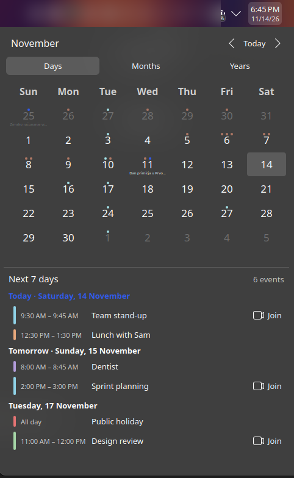

# 7-Day Agenda

A KDE Plasma 6 panel widget in the spirit of [Itsycal](https://www.mowglii.com/itsycal/) for macOS.



In the panel it shows the time with the date under it, like the Digital Clock. Clicking it opens a popup with:

- a month grid, with dots on days that have events;
- the events for the selected day and the 7 days after it (today by default), skipping days with nothing on;
- a **Join** button on events that have a Google Meet, Zoom, Microsoft Teams or Webex link.

It is read-only: it does not create or edit events.

## Where the events come from

The widget uses the same event plugins as Plasma's Digital Clock calendar:

- **PIM Events**: calendars from accounts added in KOrganizer or Merkuro (for example Google Calendar through the Google Groupware resource);
- **Holidays**: public holidays for the regions chosen in the Digital Clock settings.

Which calendars are shown is Plasma's shared PIM Events setting. To change it, open a Digital Clock widget's settings and use **Calendar → PIM Events Plugin**.

## Meeting links

Plasma's calendar API does not expose meeting links, so the widget runs a small helper, `contents/tools/meeting-links.py`, which reads them from the local Akonadi calendar store. It opens the database read-only and sends nothing anywhere.

Links are matched to events by title. Two different meetings with exactly the same title get the link of the more recently synced one.

## Requirements

- KDE Plasma 6
- `kdepim-addons` (provides the PIM Events plugin) and a calendar account set up in KOrganizer or Merkuro
- Python 3, for the meeting-link helper
- Akonadi using its default SQLite backend, for the meeting-link helper

## Install

```bash
git clone https://github.com/vanjaz/plasma-7day-agenda.git ~/.local/share/plasma/plasmoids/local.agenda7
```

Then restart the Plasma shell, right-click the panel, choose **Add or Manage Widgets**, and add **7-Day Agenda**.

```bash
systemctl --user restart plasma-plasmashell.service
```

## Configuration

There is no settings page. The number of days listed is the `daysAhead` value near the top of `contents/ui/main.qml`.

The month grid starts the week on the day set in KOrganizer under **Settings → Configure KOrganizer → General → Time & Date → Weekly start day**. If that is not set, it follows the system locale. The setting is re-read each time the popup opens.

## Licence

MIT. See [LICENSE](LICENSE).
